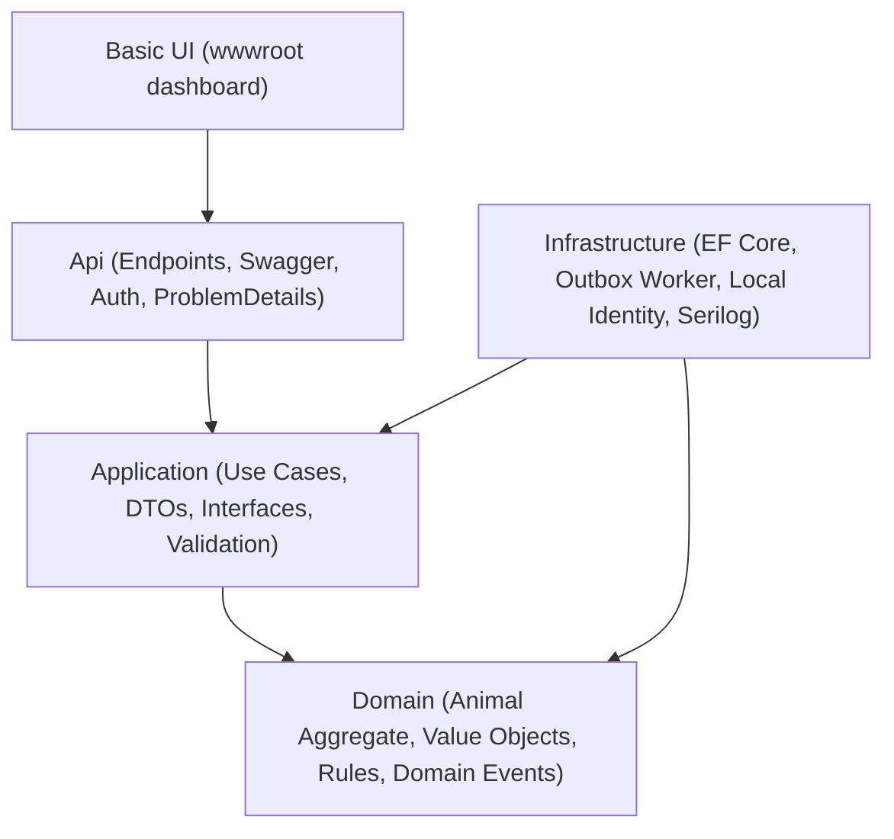

# Animal Movements API (.NET 10)

A Domain-Driven Design (DDD) / Onion Architecture REST API for recording, storing, and retrieving animal movements, complete with:

- **Onion Architecture**: `Domain` (zero dependencies) → `Application` → `Infrastructure` & `Api`
- **All 6 Business Rules** enforced inside the `Animal` Aggregate Root
- **HTTP Semantics**: `201 Created`, `200 OK` (with empty history for unknown animals), `400 Bad Request` (bad/missing input), `422 Unprocessable Entity` (domain rule violations), `401 Unauthorized`, `409 Conflict`, sanitized `500 Internal Server Error` (RFC 9457 `ProblemDetails`)
- **Outbox Pattern**: Domain events are atomically persisted to `OutboxMessages` in the same EF Core transaction and dispatched by `OutboxProcessor`
- **Pluggable Identity**: Local EF Core + JWT store by default, switchable to an external OIDC IdP (Entra ID, Auth0, Keycloak) via configuration
- **Verbose Structured Logging**: Serilog with Correlation IDs + live in-memory buffer
- **Swagger UI** (`/swagger`) and **Self-Contained Observability Dashboard** (`/`) with live verbose logs, outbox queue monitor, and automated test runner

---

## Architecture (DDD Onion Model)

Dependencies point strictly inward toward the **Domain**. No inner layer references an outer layer.



---

## Quick Start

### Option 1: VS Code / Local .NET 10 (SQLite + EF Core)

```bash
dotnet test AnimalMovements.sln
dotnet run --project src/AnimalMovements.Api
```

Or press **F5** in VS Code (uses `.vscode/launch.json`).

- **Observability Dashboard**: `http://localhost:5080/`
- **Swagger UI**: `http://localhost:5080/swagger`
- **Demo Credentials** (auto-seeded in Local mode): `demo@animalmovements.local` / `DemoPass123!`

### Option 2: Docker or Podman (API + Separate DB Container)

```bash
# Docker
docker compose up --build

# Podman
podman compose up --build
```

> **Note on separate DB container**: Because SQLite is an embedded file database, `compose.yaml` runs the API container alongside a separate `postgres:17-alpine` database container using the same EF Core `DbContext` (`Database:Provider=Postgres`). If you prefer SQLite inside a container with a persistent volume, run `docker compose -f compose.sqlite.yaml up --build` (or `podman compose -f compose.sqlite.yaml up --build`).

---

## Switching to an External Identity Provider

No Domain or Application code changes are required. Update `appsettings.json` (or environment variables):

```json
"Auth": {
  "Mode": "External",
  "Authority": "https://login.microsoftonline.com/<tenant-id>/v2.0",
  "Audience": "api://<your-app-id>",
  "SeedDemoUser": false
}
```

When `Auth:Mode` is `External`, the local `/api/auth/login` and `/api/auth/register` endpoints are disabled and ASP.NET Core validates JWTs directly against the external OIDC `Authority`.

---

## API Endpoints

| Method | Route | Auth | Description |
| --- | --- | --- | --- |
| `POST` | `/api/movements` | Bearer JWT | Record a new animal movement (`201`, `400`, `401`, `409`, `422`) |
| `GET` | `/api/animals/{animalId}/movements` | Bearer JWT | Retrieve ordered movement history (`200` with empty list if none, `422` if invalid ID) |
| `POST` | `/api/auth/login` | Public (Local mode) | Sign in and obtain a JWT Bearer token |
| `POST` | `/api/auth/register` | Public (Local mode) | Register a local user and obtain a JWT Bearer token |
| `GET` | `/api/diagnostics/logs` | Public | Query live verbose structured logs |
| `GET` | `/api/diagnostics/outbox` | Public | Inspect Outbox eventual consistency queue |
| `POST` | `/api/diagnostics/run-tests` | Public | Execute automated business-rule verification suite |
